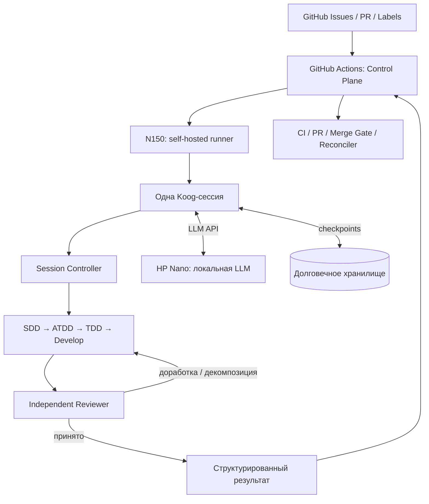

# Koog Agent Runtime — архитектура интеграции с GitHub Actions

> **Версия:** 0.1 (первый черновик)  
> **Дата:** 2026-10-12  
> **Статус:** RFC / проектное решение, **не реализовано**  
> **Репозиторий агента:** `YuriiSokolenko/recursive-coder`  
> **Интеграционный проект:** `YuriiSokolenko/social-mcp`  
> **Основная идея:** GitHub управляет жизненным циклом задач, а Kotlin/Koog — жизненным циклом агентов внутри одного GitHub Actions job.

## 1. Цель

Создать новый агентный runtime на **Kotlin/JVM + JetBrains Koog** без переписывания уже работающего GitHub Control Plane и инфраструктуры выполнения.

Граница ответственности намеренно узкая:

- **GitHub Actions** планирует и запускает задачи, выделяет runner, отслеживает внешние статусы, исполняет CI и решает, когда PR можно слить.
- **Koog** получает одну задачу и управляет её **внутренней агентной сессией**: декомпозицией, последовательностью SDD → ATDD → TDD → Develop, проверками, внутренними повторами и результатами.
- **N150** выполняет GitHub Actions runner и процесс Kotlin/Koog.
- **HP Nano** предоставляет общую локальную LLM через совместимый API. Koog не управляет запуском или переключением модели.

**Базовое правило: один GitHub Actions job запускает одну логическую Koog-сессию.** Внутри неё могут быть многочисленные агенты, вложенные подзадачи и итерации, не требующие новых GitHub jobs или Issues.

> Повторный запуск GitHub job — новая попытка исполнения **той же логической сессии**, если входные данные и политика восстановления допускают resume. Физический процесс Koog может быть новым.

## 2. Не-цели v0.1

На первом этапе **не планируется**:

1. Переносить очередь GitHub Issues, глобальный Dispatcher, зависимости Issues и расписание в Koog.
2. Переписывать существующие GitHub Actions YAML, autoscaler, self-hosted runner, CI и Merge Gate без необходимости.
3. Заменять GitHub как источник истины о внешнем состоянии задачи и PR.
4. Сразу переписывать весь Pi Implementer и его защитные механизмы.
5. Создавать GitHub Issue или workflow на каждую внутреннюю рекурсивную подзадачу.
6. Переносить инференс с HP Nano на N150, менять модель или вводить произвольные ограничения параллелизма.
7. Реализовывать систему прямо в рамках этого документа: здесь описана **целевая архитектура**, а не готовый функционал.

## 3. Общая схема



**Важно:** диаграмма описывает логические компоненты. Она не предписывает отдельный сетевой сервис для Koog: предпочтительно запускать Kotlin/JVM CLI в рамках job.

## 4. Разделение ответственности

| Область | GitHub Control Plane | Koog Agent Runtime |
|---|---|---|
| Очередь внешних задач | Владелец | Не управляет |
| Issue labels, глобальные зависимости, приоритеты | Владелец | Читает необходимые входные данные |
| Запуск, отмена и повтор GitHub job | Владелец | Реагирует на сигнал остановки |
| Выделение runners и инфраструктурный autoscaling | Владелец | Не управляет |
| Порядок агентов **внутри job** | Не управляет | Владелец |
| Внутренняя декомпозиция задачи | Получает агрегированный результат | Владелец |
| Рекурсия, внутренние retry и локальный review | Не управляет | Владелец |
| Политика доступа агентов к файлам/инструментам | Требует выполнения контракта | Применяет через доверенные механизмы |
| Checkpoints внутренней сессии | Предоставляет/связывает долговечное хранение | Создаёт и восстанавливает |
| Публикация PR и финальных внешних статусов | Владелец | Возвращает проверяемый результат/артефакты |
| Глобальный CI, Merge Gate, post-merge и Reconciler | Владелец | Не подменяет |

Глобальные стадии существующего workflow могут сохраняться как самостоятельные GitHub jobs. **Владение Koog ограничено границами конкретного job**, а не всего репозитория или набора Issues.

## 5. Логическая Koog-сессия

### 5.1. Входной контракт

При запуске Koog получает версионированное описание сессии (`SessionRequest`). Минимальная семантика:

- Идентичность репозитория, Issue/PR и требуемой ветки/ревизии.
- **Стабильный `sessionId`** для восстановления логической работы; отдельный `attemptId` для конкретного job/run.
- Текст задачи и разрешённый scope изменений.
- Тип требуемого workflow и политики стадий.
- Набор доступных инструментов, бюджеты и временной deadline от внешнего orchestration layer.
- Пути к worktree, артефактам, хранилищу состояния и модели.
- Версии контракта, runtime и политики, чтобы обнаруживать несовместимые resume.

Идентификатор GitHub run **не должен быть единственным** идентификатором сессии: при retry он меняется. Правило вычисления стабильного ключа должно быть детерминированным и исключать смешивание разных ревизий задачи.

### 5.2. Жизненный цикл

`CREATED → RESTORING? → RUNNING → VALIDATING → COMPLETED`

Дополнительные терминальные состояния: `FAILED`, `CANCELLED`, `NEEDS_HUMAN`, `RETRYABLE_FAILURE`. Возможность продолжения после сбоя не равна успешному завершению.

Session Controller отвечает за:

- дедлайны, прогресс, бюджет модели и инструментальных вызовов;
- запуск и завершение подагентов, контроль глубины рекурсии;
- безопасные точки checkpoint и восстановление;
- контроль прав инструмента до выполнения действия;
- наблюдаемость: события, причины решений, метрики, связи parent/child;
- итоговый детерминированно валидируемый результат.

### 5.3. Выходной контракт

`SessionResult` — структурированный итог, а не произвольное сообщение модели:

- `sessionId`, `attemptId`, версия схемы;
- `status`: `completed | needs_human | failed | cancelled | retryable_failure`;
- итоги по агентам, проверкам и изменённым файлам;
- ссылки/пути на manifest артефактов и проверенный результат работы;
- безопасная диагностическая информация и статистика токенов/времени;
- признак разрешённости продолжения с checkpoint и указание причины ошибки;
- при необходимости — проверяемые данные для последующего оформления PR.

**Смена GitHub labels, публикация результата и Merge Gate остаются за доверенным внешним слоем.** LLM не получает бесконтрольное право публиковать успешный внешний статус.

## 6. Рекурсивный агентный процесс

Основной логический процесс:

```text
Task
  └─ SDD Agent          — формализует требования и критерии
      └─ ATDD Agent     — формирует приёмочные тесты
          └─ TDD Agent  — формирует технические тесты
              └─ Developer Agent — реализует решение
                  └─ Independent Reviewer — проверяет соответствие
```

На **любой стадии** агент может определить, что задача недостаточно атомарна. Тогда контроллер создаёт внутренние дочерние задачи, запускает для каждой ту же цепочку в рамках **той же Koog-сессии** и после этого выполняет интеграцию и валидацию на родительском уровне.

Условия рекурсивной декомпозиции должны определяться по проверяемым сигналам: ограниченность области работы, оценка сложности, отсутствие достаточного контекста, наличие независимых частей, несоответствие тестам и невозможность безопасной реализации целиком. Один лишь субъективный ответ LLM не должен бесконтрольно углублять дерево.

**Обязательные ограничения рекурсии:** лимиты на глубину, число узлов/вызовов, общий дедлайн, бюджет, и защита от повторяющегося разбиения на идентичные задачи. Конкретные численные значения задаются политиками конфигурации после измерений, а не жёстко фиксируются данным RFC.

### 6.1. Разделение агентов

Каждую стадию обслуживает **отдельная агентная роль** с отдельными инструкциями, разрешениями и журналом решений. Роли могут обращаться к одной физически запущенной LLM на HP Nano.

| Агент | Разрешённая основная работа | Запрещённое без отдельной процедуры |
|---|---|---|
| SDD | Спецификация, требования, границы и критерии | Изменение реализации |
| ATDD | Приёмочные тесты по согласованной спецификации | Скрытое изменение требований |
| TDD | Технические тесты по спецификации/ATDD | Переписывание приёмочных критериев |
| Developer | Производственный код, разрешённые конфигурации | Изменение спецификаций, ATDD- и TDD-тестов |
| Reviewer | Проверка соответствия, отчёт, запрос исправлений | Незаметная модификация проверяемого результата |

Диаграмма классов/архитектурный эскиз от Orbit может предоставляться Developer **как необязательная рекомендация**, а не как жёсткий blueprint.

### 6.2. Неизменяемость спецификаций и тестов

Это **инвариант безопасности**, а не только текст промпта:

1. После утверждения выходного артефакта стадии нижестоящий агент получает его как read-only.
2. Developer не вправе менять файлы или семантику тестов, подготовленных ATDD/TDD, и спецификацию SDD.
3. Корректировка тестов выполняется через отдельный контролируемый и рецензируемый переход на соответствующую стадию; решение фиксируется в audit trail.
4. Ограничения применяются **на уровне доверенного executor/worktree policy**, с последующей проверкой diff и manifest, даже если модель пытается обойти запрет через shell или переименование.
5. Локальный Reviewer не заменяет внешние CI и Merge Gate.

### 6.3. Параллельность

Независимые подзадачи **могут** исполняться параллельно при наличии безопасной изоляции рабочих деревьев и бюджета. Параллелизм нельзя разрешать для агентов, одновременно изменяющих одно и то же рабочее состояние без согласованной интеграции. Координация глобальной загрузки HP Nano остаётся инфраструктурной задачей, а не отдельным scheduler внутри Koog.

## 7. Инструменты и защитные механизмы

Koog предоставляет инфраструктуру агентных вызовов и orchestration, но не заменяет специфические политики нашего harness. Должны быть сохранены (или повторно реализованы с тестовой эквивалентностью):

- ограниченный `read / search / edit / execute` tool surface по ролям;
- проверка разрешённых путей, symlink containment и запрет изменения control-plane;
- разрешение и учёт mutation scope, безопасные правки, журнал изменений;
- validation ledger, `run_check` и конечная доверенная проверка;
- recovery и rollback с защитой от повреждённого/неполного состояния;
- дедлайны, ограничение непродуктивных вызовов и семантических циклов;
- audit trail и проверяемый terminal receipt;
- безопасная обработка ошибок provider, streaming и tool-call протокола.

**Перенос не должен снижать действующие гарантии безопасности.** Старый Pi Implementer остаётся рабочим backend до достижения проверенного функционального parity.

## 8. Восстановление после сбоев

Одного встроенного механизма persistence недостаточно, пока не подтверждено, что он сериализует все необходимые аспекты нашей сессии. Проектируем собственный проверяемый контракт checkpoint.

### 8.1. Требования

- Checkpoint должен переживать уничтожение ephemeral container и отключение питания N150.
- Хранилище не должно быть единственной временной директорией GitHub Actions runner.
- Состояние включает версию дерева задач, завершённые этапы, артефакты, бюджеты, validation receipts и границы безопасного повтора.
- Незавершённые действия, особенно git/GitHub side effects, должны повторяться **идемпотентно** либо требовать сверки результата перед повтором.
- Восстановление запрещено при несовместимой схеме, конфликте владения сессией или невалидном checkpoint.
- Секреты/токены и произвольные приватные tool outputs не должны попадать в публикуемые checkpoints и логи.

### 8.2. Варианты хранения (решение ещё не принято)

Возможны GitHub Actions artifacts, выделенное внешнее object storage или надёжно реплицируемое хранилище. Локальный volume на N150 **сам по себе недостаточен** для сценария полной потери машины. Для воспроизводимости отдельно нужны git refs/commits либо сохранённые изменения и manifest файлов.

Публикация checkpoint должна быть атомарной на уровне выбранного backend. Требуется политика retention, очистка завершённых сессий и механизм session lease/lock против двух одновременных восстановлений.

## 9. Интеграция с HP Nano

- Koog обращается к локальной модели через **настраиваемый endpoint**; существующий маршрут `:4001/v1` — исходный кандидат.
- Используются существующие model IDs и конфигурация backend; модель не привязывается жёстко к коду.
- Контекст до **256K** рассматривается как свойство текущей конфигурации инференса, а не гарантия автоматической поддержки всего объёма Koog.
- До полноценной миграции требуется фактическая проверка совместимости: OpenAI-compatible / Open Responses transport, streaming, tool calling, tool choice, structured output, usage accounting, длинные сессии, таймауты и retry.
- Одновременно запущенные GitHub jobs могут обращаться к одной модели; выбор общего concurrency определяется реальными нагрузочными тестами, а не вводится этим документом.

## 10. Миграция без остановки существующей системы

### Этап A — контракт и proof of compatibility

Зафиксировать `SessionRequest`/`SessionResult`, ownership, инварианты разрешений, устойчивые идентификаторы; проверить Koog ↔ локальная LLM на минимальных tool-call сценариях. **Gate:** совместимость подтверждена тестами, отдельный Kotlin CLI запускается на N150.

### Этап B — первый агент

Запустить Koog в одном неопасном сценарии (например, read-only анализ или Reviewer), сохранив текущий GitHub caller. **Gate:** структурированный выход и наблюдаемость совпадают с ожиданиями внешнего workflow.

### Этап C — рекурсивный пайплайн

Ввести раздельные SDD, ATDD, TDD, Developer и Independent Reviewer; вложенные задачи, разрешения на файлы и интеграцию. **Gate:** Developer не может изменить защищённые тесты; защита проходит негативные тесты.

### Этап D — надёжность

Checkpoint/resume, retry, cancellation, идемпотентные side effects, бюджет и прогресс. **Gate:** принудительная остановка job/runner не приводит к тихой потере прогресса или двойной публикации.

### Этап E — постепенная замена Pi

Сравнить Koog и Pi на одинаковых тестовых пакетах и метриках; переносить специфические guardrails Implementer небольшими порциями. **Gate:** безопасность, recovery и качество не хуже текущего runtime. До этого допустим **гибрид Koog + Pi**.

**Стратегия переключения:** feature flag/выбор backend на уровне существующего запуска job; сохранение возможности rollback на Pi.

## 11. Наблюдаемость и критерии готовности

Минимальный набор метрик:

- `sessionId` / `attemptId`, GitHub run/job, версия runtime и модели;
- дерево parent/child, агент и текущая стадия;
- продолжительность стадий, число model requests, входные/выходные токены, ошибки provider;
- число циклов review/fix и уровень рекурсии;
- результаты тестов, запрещённые попытки изменения файлов, validation receipts;
- число и причины resume/retry, сохранённый прогресс и окончательный статус.

**Definition of Done для первой рабочей версии:**

1. Одна задача запускается одним GitHub Actions job в виде одной Koog-сессии.
2. Koog управляет несколькими ролями и может выполнять рекурсивную подзадачу без дополнительного GitHub Issue/job.
3. Для Developer технически запрещены изменения утверждённых SDD/ATDD/TDD артефактов.
4. Результат передаётся во внешний слой через валидируемый контракт, без обхода CI/Merge Gate.
5. Сессия корректно обрабатывает отмену и может безопасно продолжаться или явно отказываться от resume после сбоя.
6. Все внешние побочные эффекты и ошибки отражены в диагностике; имеются регрессионные тесты.
7. При ошибках есть поддерживаемый rollback на текущий Pi backend.

## 12. Открытые решения

| Вопрос | Предварительное направление |
|---|---|
| Формат входа/выхода | Версионированный JSON-контракт; детали схем отдельно |
| Запуск | Kotlin/JVM CLI на N150 как часть существующего GitHub job |
| Persistence | Внешнее долговечное хранение + git-recoverable изменения; backend выбрать после эксперимента |
| Изоляция подзадач | Отдельные worktrees или эквивалентная проверяемая изоляция при конкурентной записи |
| Максимальная глубина и бюджеты | Настраиваемые политики по результатам нагрузочного профиля |
| Когда рекурсировать | Формализованные критерии атомарности + контроль повторной декомпозиции |
| Как изменять утверждённые тесты | Только через отдельную reviewed correction процедуру |
| Orbit class diagram | Необязательная подсказка Developer |
| Pi coexistence | Поддержка на период поэтапной миграции |
| Koog transport и model compatibility | Отдельный обязательный интеграционный тест на нашем endpoint |

## 13. Зафиксированные архитектурные решения

**ADR-001.** GitHub остаётся глобальным Control Plane и источником истины для Issues/PR/CI/Merge Gate.

**ADR-002.** Одна GitHub Actions job запускает одну логическую Koog-сессию; повторные попытки могут восстанавливать ту же сессию.

**ADR-003.** Вся внутренняя оркестрация агентов и рекурсивная декомпозиция принадлежат Koog. Внутренние дочерние задачи не требуют создания GitHub Issues.

**ADR-004.** Базовый процесс — **SDD → ATDD → TDD → Develop → Independent Review**; он применяется рекурсивно до атомарных подзадач с последующей интеграцией на родительском уровне.

**ADR-005.** Developer не может редактировать спецификации или тесты, созданные другими стадиями. Исключение — отдельная контролируемая и рецензируемая процедура.

**ADR-006.** GitHub runners и HP Nano остаются на текущих ролях. Kotlin/Koog внедряется без обязательного развёртывания дополнительного постоянного сервиса.

**ADR-007.** Переход инкрементальный; существующий Pi runtime сохраняется до доказанного parity по безопасности, функциональности и восстановлению.

---

### Следующая редакция (v0.2)

Уточнить схему `SessionRequest`/`SessionResult`, жизненный цикл checkpoint, границы mutation/tool authorization, дерево рекурсивного исполнения и критерии `atomic task`; затем согласовать минимальный proof of concept **без изменения действующих production workflows**.